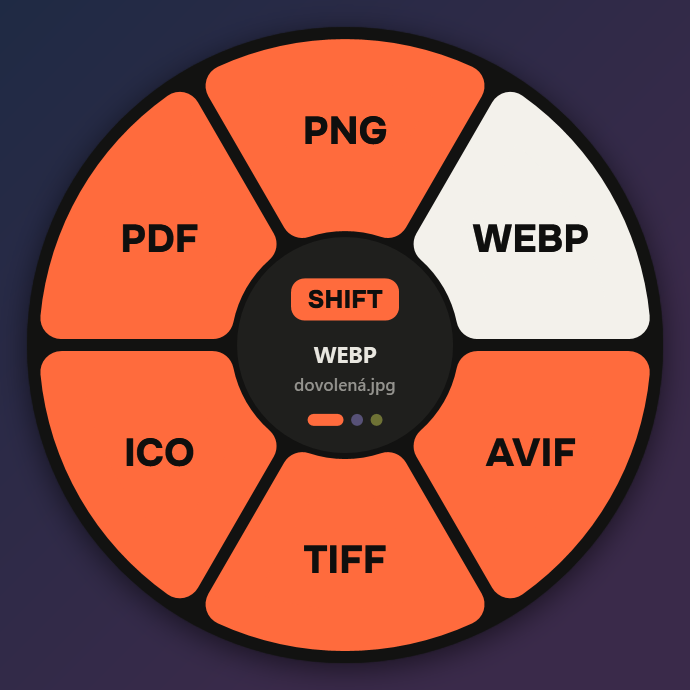
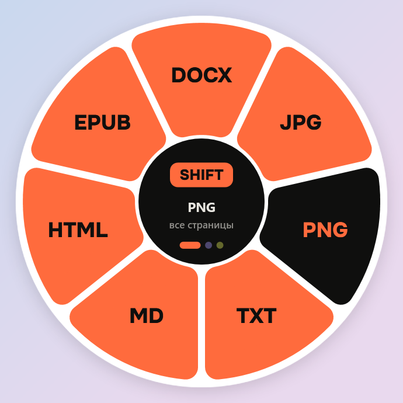
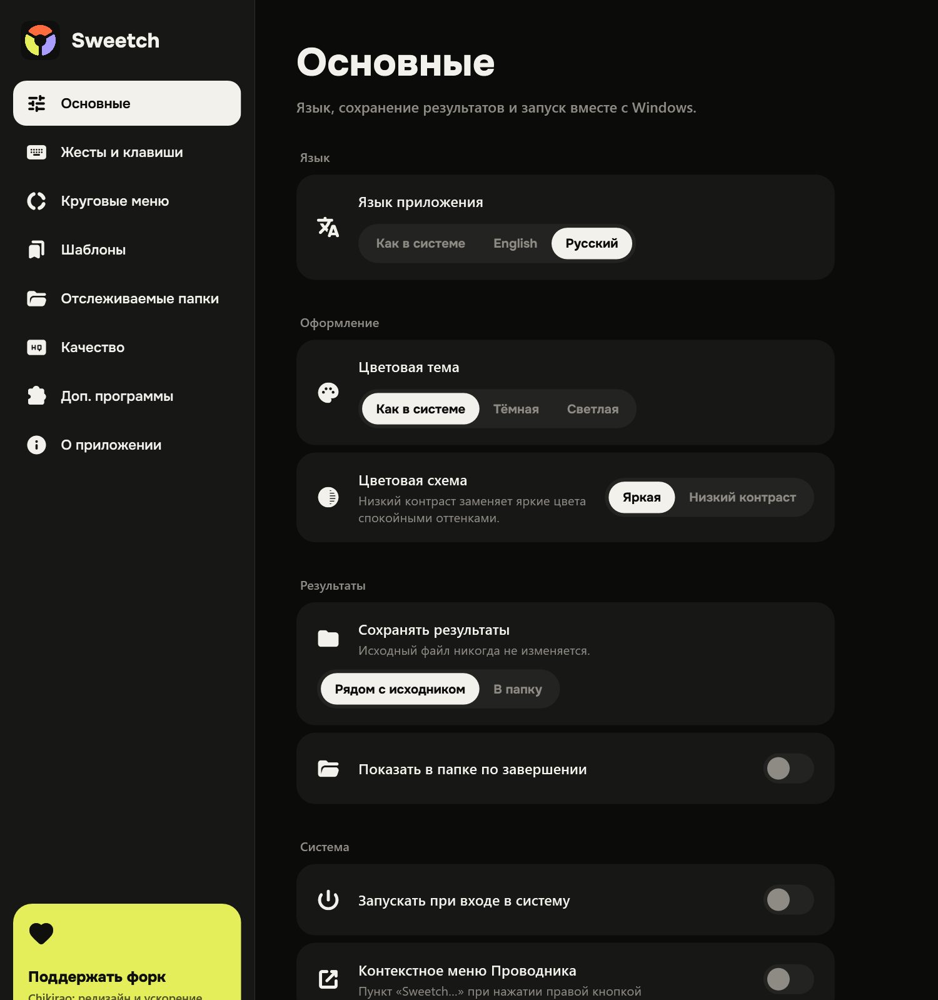
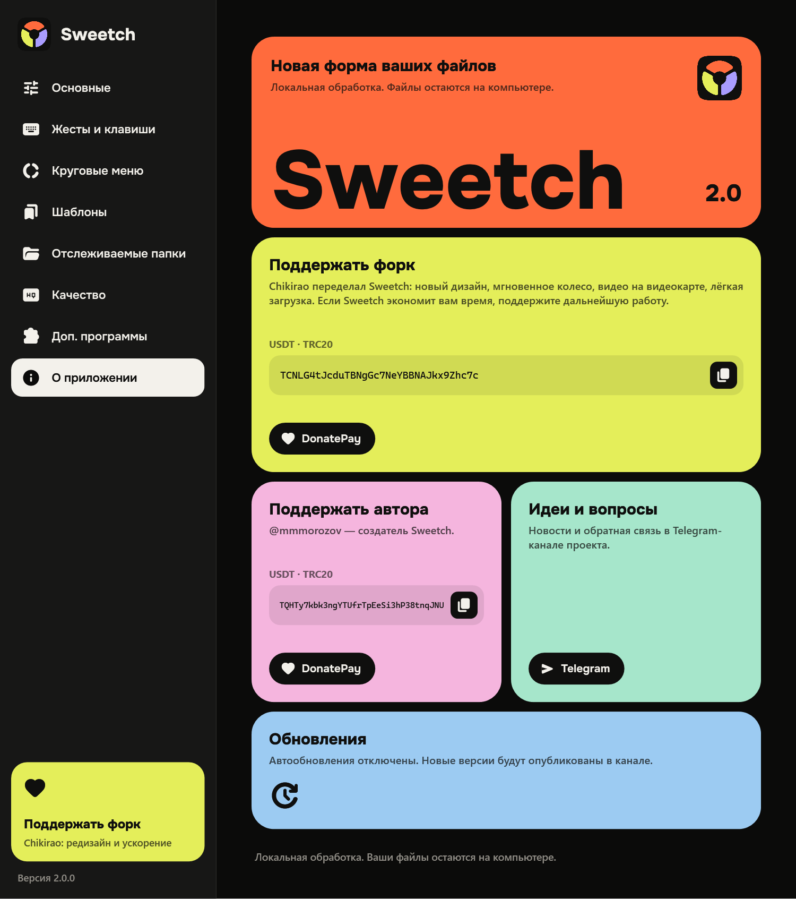
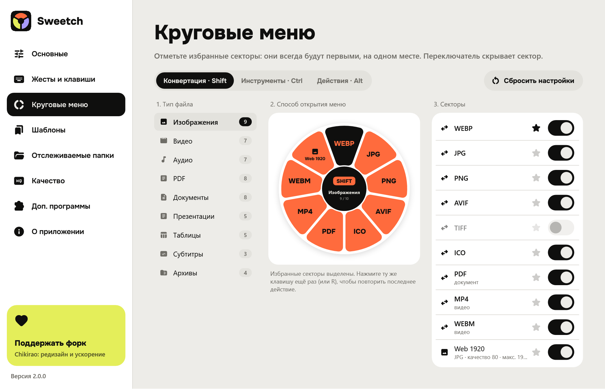

# Sweetch 2.0

Файловый конвертер для Windows с круговым меню: перетащите файл, нажмите **Shift**, **Ctrl** или **Alt** и отпустите его над нужным сектором.

**Это форк** [krllmrzv/Sweetch](https://github.com/krllmrzv/Sweetch) от [Chikirao](https://github.com/chikirao): полный редизайн и оптимизация. Автор оригинального Sweetch — [@mmmorozov](https://t.me/mmmorozov).

<p align="center">
  
  
</p>
<p align="center">
  
  
</p>
<p align="center">
  
</p>

## Что нового в 2.0

**Редизайн**

- Колесо из крупных цветных блоков: свой цвет для каждой клавиши — Shift, Ctrl и Alt. Без всплывающих секторов, свечения и анимаций.
- Жирный шрифт Onest и залитые иконки Material Symbols, встроенные в программу.
- Новые настройки: цветные плитки, понятные разделы, тонкая полоса прокрутки, раскладка подстраивается под узкое окно.
- Схема «Низкий контраст» со спокойными цветами вместо ярких, тёмная и светлая темы.
- Новый логотип и иконка в трее.

**Оптимизация**

- Колесо открывается мгновенно (около 5 мс) и сразу закрывается после отпускания файла.
- Видео кодируется на видеокарте (NVIDIA, Intel, AMD), если она это умеет: на NVIDIA в 3–4 раза быстрее. Если не получилось, Sweetch сам перекодирует на процессоре.
- Пачки картинок обрабатываются параллельно: 12 фото в WebP за 3,8 с вместо 10,4 с.
- Многостраничные PDF в картинки — в разы быстрее (400 страниц: 3,3 с → 0,24 с).
- Программа стала вдвое меньше: Pandoc больше не входит в сборку и скачивается при первой конвертации документа (355 МБ → 160 МБ на диске).
- Таблицы XLSX/CSV больше не сканируют все шрифты Windows; исправлена ошибка доступа к папке шрифтов.
- В фоне программа занимает около 60 МБ памяти.

## Скачать

| Вариант | Скачать | Как запустить |
| --- | --- | --- |
| **Установщик EXE** | [Sweetch 2.0 — установить](https://github.com/chikirao/Sweetchiki/releases/download/v2.0/Sweetch-2.0-Setup-win-x64.exe) | Запустите установщик. Он добавит программу в меню «Пуск» и позволит удалить её через настройки Windows. |
| **Архив ZIP без установки** | [Sweetch 2.0 — скачать архив](https://github.com/chikirao/Sweetchiki/releases/download/v2.0/Sweetch-2.0-win-x64.zip) | Распакуйте всю папку и запустите `Sweetch.exe`. |

Оба варианта содержат готовую программу и .NET. Нужна Windows 10 (1809+) или Windows 11, x64. [Все файлы релиза и контрольные суммы SHA-256](https://github.com/chikirao/Sweetchiki/releases/tag/v2.0). Прежняя версия 1.0 — в [оригинальном репозитории](https://github.com/krllmrzv/Sweetch/releases/tag/v1.0).

## Запуск

Программа живёт в области уведомлений рядом с часами; двойной щелчок открывает настройки.

Перетащите файл и нажмите **Shift** для конвертации, **Ctrl** для инструментов или **Alt** для действий. Отпустите файл над нужным сектором; в центре — отмена. Без мыши: выберите файлы в Проводнике и нажмите **Ctrl + Alt + Space**.

Язык: **Как в системе / Русский / English**. Тема: **Как в системе / Тёмная / Светлая**, схема: **Яркая / Низкий контраст**.

Настройки хранятся в `%APPDATA%\Sweetch`, загружаемые программы — в `%LOCALAPPDATA%\Sweetch\tools`. Скриншоты и виртуальные вложения сохраняются в `Downloads\Sweetch`. Исходные файлы не перезаписываются.

## Форматы

Изображения (включая RAW с камер: CR2/CR3, NEF, ARW, RAF, DNG, ORF, RW2 и др.), аудио, видео, PDF, документы, таблицы, презентации, субтитры и архивы. Доступные операции зависят от типа файла.

Pandoc для документов (DOCX, Markdown, HTML, EPUB, RTF, TXT) и FFmpeg для аудио и видео скачиваются при первой конвертации, которой они нужны, с проверкой SHA-256. LibreOffice для части операций Office/PDF устанавливается отдельно. Пока чего-то не хватает, настройки напоминают об этом плашкой с переходом в «Доп. программы». Обработка файлов локальная.

## Поддержать

**Форк — Chikirao.** Редизайн, оптимизация и эта версия Sweetch. Если программа экономит вам время, поддержите дальнейшую работу:

- [DonatePay](https://donatepay.ru/don/1539219)
- USDT · TRC20: `TCNLG4tJcduTBNgGc7NeYBBNAJkx9Zhc7c`

**Оригинальный Sweetch — @mmmorozov:**

- [DonatePay](https://donatepay.ru/don/1539048)
- USDT · TRC20: `TQHTy7kbk3ngYTUfrTpEeSi3hP38tnqJNU`
- [Telegram-канал](https://t.me/mmmorozov)

Автообновления отключены: Sweetch не обращается к серверу обновлений и не устанавливает сторонние версии. Обратная связь открывает Telegram; встроенной отправки сообщений на сторонний сервер нет.

## Сборка

Нужен .NET SDK 10; если его нет, `build.ps1` сам скачает его в папку `.dotnet`. Перед сборкой закройте Sweetch, если он запущен из `publish`. В PowerShell из папки проекта:

```powershell
./build.ps1
dotnet test tests/Sweetch.Tests -c Release
./publish/Sweetch.exe --self-test ./self-test
```

Self-test рисует все экраны в `self-test/` (обе темы, оба языка, минимальная ширина окна) и пишет в `self-test.txt` время открытия колеса и страниц настроек.

Для установщика нужен [Inno Setup 6 или 7](https://jrsoftware.org/isdl.php): после `build.ps1` выполните `./scripts/build-installer.ps1`. Результат появится в `artifacts/`.

GitHub Actions проверяет программу и установку, создаёт ZIP и установщик EXE с контрольными суммами и публикует их в релизе по тегу `v*`. Отдельный workflow **Publish installer for existing release** добавляет установщик к уже выпущенному ZIP, проверяя его SHA-256.

## Лицензия

См. `LICENSE` и `THIRD-PARTY-NOTICES.md`. В них сохранены обязательные уведомления об авторских правах на используемый код и зависимости. Название Sweetch — проект @mmmorozov; редизайн и оптимизация версии 2.0 — Chikirao.
